# ADDSlab

## Active Directory Lab Structure

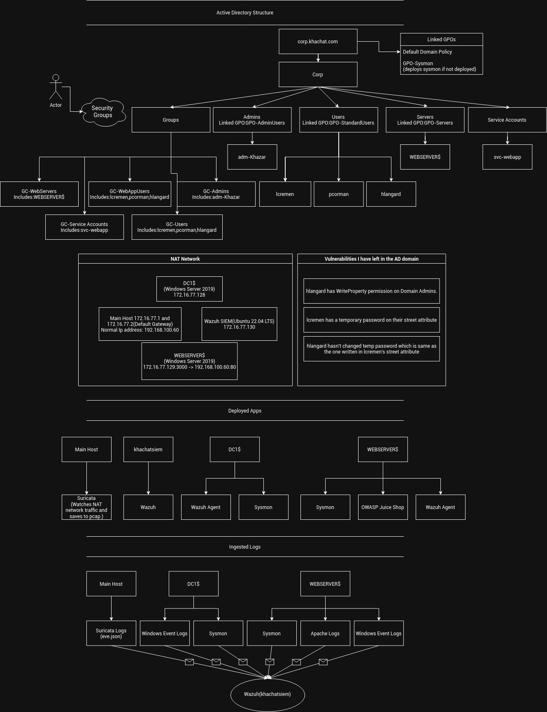

## My Active Directory Deployment Process

Accounts
> Administrator - Password:HellDiver40000

Commands that I have ran:

> ADDS Install

`Install-WindowsFeature -name AD-Domain-Services -IncludeManagementTools`

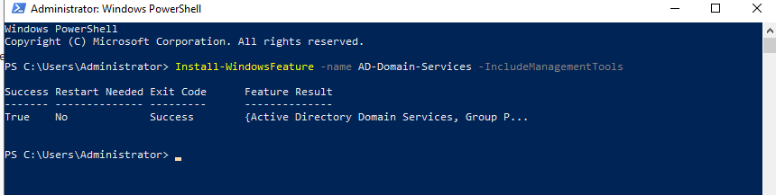

`Install-ADDSForest -DomainName "corp.khachat.com"`

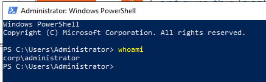

Created this structure:

- Corp
	+ Corp - GPO BaseLine(GPO)
	- Users(OU)
		+ Louliette Cremen
		+ Helcon Langard
		+ Protoc Frank Corman
		+ GPO-StandardUsers
	- Admins(OU)
		+ GPO-AdminUsers
		+ adm-Khazar
	- Service Accounts(OU)
		+ svc-webapp
	- Servers(OU)
		+ WEBSERVER$(Computer)
		+ GPO-Servers
	- Groups(OU)
		+ GC-Admins(adm-Khazar)
		+ GC-Users(hlangard,lcremen,pcorman)
		+ GC-Service Accounts(svc-webapp)
		+ GC-WebApp_Users(hlangard,lcremen,pcorman)
		+ GC-WebServers(WEBSERVER$)

Added users:
- Protoc Frank Corman - Password:TastyLemon2026
- Helcon Langard - Password:FrankSinatra2026!
- Louliette Cremen - Password:SheLovesLat2Coffee
- adm-Khazar - Password:DecepticonsNeverDie1000


Created another VM with Account:

- Administrator - Password:ProblematicServer49

Created a service account
- svc-webapp - Password:ChangeMe123!


Put password of hlangard to lcremen's address part. This way writing temporary password into more hidden address part and then to forget to delete it would be acceptable scenario.

Blocked powershell.exe and cmd.exe, so attacker needs to copy powershell file to another folder or use rundll32.exe and alike executables to run powershell code.
```
Computer Configuration->Policies->Windows Settings->Security Settings->Software Restriction Policies
```

## All GPO changes/adds:

### GPO 1: Default Domain Policy - Applied to everyone

- Password Policy
Computer Configuration → Policies → Windows Settings → Security Settings → Account Policies → Password Policy

| Setting	| Value |
| ------- | ----- |
|Enforce password history	| 2|
|Maximum password age	|42 days|
|Minimum password age	|1 day|
|Minimum password length	|7|
|Password must meet complexity requirements	|Enabled

- Account Lockout Policy
Computer Configuration → Policies → Windows Settings → Security Settings → Account Policies → Account Lockout Policy

| Setting	| Value |
| ------- | ----- |
|Account lockout threshold	|3 invalid attempts|
|Account lockout duration	|10 minutes|
|Reset account lockout counter after|	3 minutes|
|Allow Administrator account lockout |Enabled|

- Audit Policy
Computer Configuration → Policies → Windows Settings → Security Settings → Advanced Audit Policy Configuration → Audit Policies

|Category	| Setting	| Value |
| -------- | ------- | ----- |
|Account Logon	|Audit Kerberos Authentication Service	|Success, Failure|
|Account Logon	|Audit Kerberos Service Ticket Operations	|Success, Failure|
|Logon/Logoff	|Audit Logon	|Success, Failure|
|Detailed Tracking	|Audit Process Creation	|Success, Failure|
|DS Access	|Audit Directory Service Access	|Success, Failure|

- Enable command-line logging:
Computer Configuration → Policies → Administrative Templates → System → Audit Process Creation → Include command line in process creation events → Enabled

### GPO 2: GPO-StandardUsers - Applied to lcremen, pcorman, hlangard

- User Configuration → Policies → Administrative Templates → Control Panel Prohibit access to Control Panel and PC settings → Enabled
- User Configuration → Policies → Administrative Templates → Control Panel → Personalization
	- Enable screen saver → Enabled
 	- Password protect the screen saver → Enabled
	- Screen saver timeout → Enabled → 600 seconds (10 min)
### GPO 3: GPO-AdminUsers - Applied to adm-Khazar

- User Configuration → Policies → Administrative Templates → Control Panel → Personalization
	- Enable screen saver → Enabled
	- Password protect the screen saver → Enabled
	- Screen saver timeout → Enabled → 300 seconds (5 min, shorter than regular users)

- User Configuration → Policies → Administrative Templates → Start Menu and Taskbar
	- Remove Run menu from Start Menu → Enabled 
	
### GPO 4: GPO-Servers - Applied to WEBSERVER$

- Computer Configuration → Policies → Windows Settings → Security Settings → Local Policies → User Rights Assignment
	- Log on as a service → Add `CORP\svc-webapp`
- Computer Configuration → Policies → Administrative Templates → Windows Components → Microsoft Defender Antivirus
	- Turn off Microsoft Defender Antivirus → Enabled
- Computer Configuration → Policies → Administrative Templates → System → Audit Process Creation
	- Include command line in process creation events → Enabled
- Computer Configuration → Policies → Windows Settings → Security Settings → Software Restriction Policies
	- New Path Rule:`C:\Windows\System32\cmd.exe`-Disallowed
	- New Path Rule:`C:\Windows\System32\WindowsPowershell\v1.0\powershell.exe`
	
## GenericWrite access

`dsacls "CN=Domain Admins,CN=Users,DC=corp,DC=khachat,DC=com" /G "CORP\hlangard:WP"`
I ran the command above. Now Helcon Langard can add new user with full permissions to domain.

## Deploying SYSMON in every device in domain.

Fetched sysmon config and sysmon64.exe from corresponding links.
Copied them to `\corp.khachat.com\SYSVOL\corp.khachat.com\scripts\sysmon\`.
Created a new GPO named GPO-Sysmon at the domain level and linked it to the domain.
Edited gpo to do this:
- Computer Configuration → Policies → Windows Settings → Scripts (Startup/Shutdown) → Startup

	- Name: `\\corp.khachat.com\SYSVOL\corp.khachat.com\scripts\sysmon\sysmondeploy.cmd`

in the cmd file there is this content:
```
@echo off
sc query Sysmon64 >nul 2>&1
if %errorlevel% equ 0 (
    exit /b 0
) else (
    \\corp.khachat.com\SYSVOL\corp.khachat.com\scripts\sysmon\Sysmon64.exe -accepteula -i \\corp.khachat.com\SYSVOL\corp.khachat.com\scripts\sysmon\sysmonconfig.xml
)
```

Which first checks if there is sysmon running if not then deploys sysmon.	


There were connection problem to WEBSERVER from DC1. So I changed one more settings in GPO-Servers:
- Computer Configuration → Policies → Windows Settings → Security Settings → Windows Defender Firewall with Advanced Security → Windows Defender Firewall with Advanced Security
	- Every firewall state: OFF
	
Now I could restart the WEBSERVER from DC1. 

## New VM for SIEM

Ubuntu 26.04 LTS
khachatsiem - Password:BlackFriday!1919

During installation of Ubuntu I chose adding openssh server by default. Now with just `ssh khachatsiem@<ipaddress>` I can work on the server.

I ran wazuh all-in-one installer script.
`curl -sO https://packages.wazuh.com/4.14/wazuh-install.sh && sudo bash ./wazuh-install.sh -a`

And now waiting for it to finish. It is really hard for my pc to be able to handle it. Because of that I might actually take AWS free tier and work on it.
 
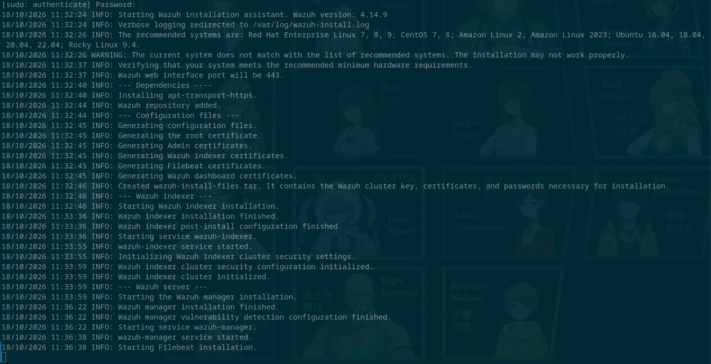

And wazuh installation finished.

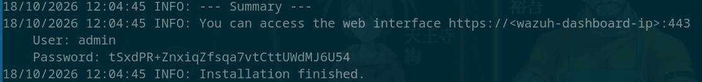

Username:admin

Password:tSxdPR+ZnxiqZfsqa7vtCttUWdMJ6U54


## Deploying Juice Shop

I first tried deploying DVWA and was succesful. But it was not what I wanted so I removed anything related to it started to deploying OWASP Juice Shop.

[Github Link to Juice Shop](https://github.com/juice-shop/juice-shop)

I installed .NET Desktop Runtime to WEBSERVER$. Then executed node.js installer. Then I downloaded Juice Shop from github as a zip and ran `npm start` command in the directory I extracted the zip archive. In config/default.yml I edited
```
challenges:
	SafetyMode: auto
```

to 

```
challenges:
	SafetyMode: disabled
```

This lets my friend to be able to find RCE vulnerabilites to the system. 

Right now I need to automate startup of Juice-Shop. I will use scheduled tasks because of this. 

```
$action = New-ScheduledTaskAction `
    -Execute "C:\Program Files\nodejs\npm.cmd" `
    -Argument "start >> logs\app.log 2>&1" `
    -WorkingDirectory "C:\Apps\juice-shop_20.3.0"

$trigger = New-ScheduledTaskTrigger -AtStartup

$settings = New-ScheduledTaskSettingsSet `
    -RestartCount 3 -RestartInterval (New-TimeSpan -Minutes 1) `
    -ExecutionTimeLimit ([TimeSpan]::Zero) `
    -StartWhenAvailable -AllowStartIfOnBatteries -DontStopIfGoingOnBatteries

Register-ScheduledTask -TaskName "JuiceShop" `
    -Action $action -Trigger $trigger -Settings $settings `
    -User "CORP\svc-webapp" `
    -Password (Read-Host "svc-webapp password") `
    -RunLevel Limited
```

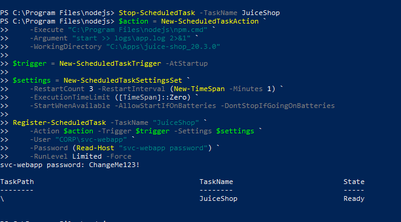

### access.log->wazuh-agent addition

After finished setting up OWASP Juice Shop I ran it with 
`Start-ScheduledTask -TaskName JuiceShop` command it created app.log file which can also be redirected to Wazuh. To be honest, it is pretty much fun to do so.

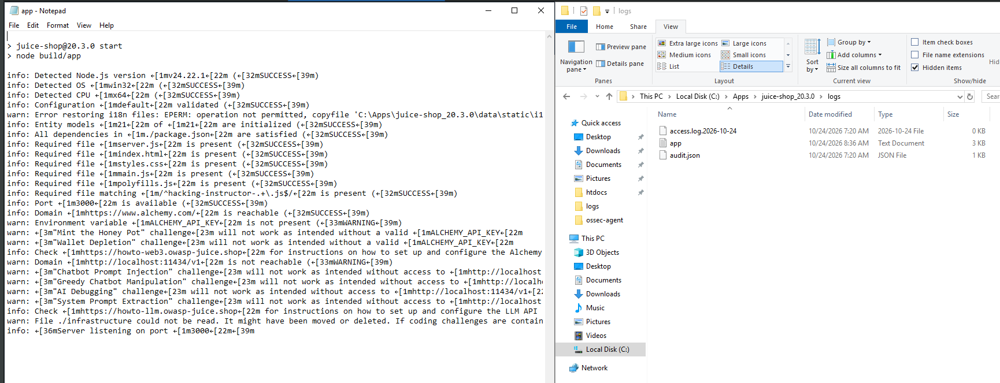

Then in the folder logs/ there was rotated log files in this name format:
access.log.YYYY-MM-DD

I added this lines to WEBSERVER$ wazuh-agent's log file `C:\Program Files(x86)\ossec-agent\ossec.conf`.

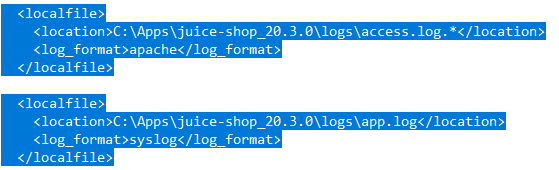

And restarted Wazuh Service with:


I also needed to write a custom decoder to decode and create custom rules for the app.logs. Why is this important? Because if pentester tries any sql injection technique or anything related to databases it will write it to app.log.

I edited wazuh-agent config again like this:

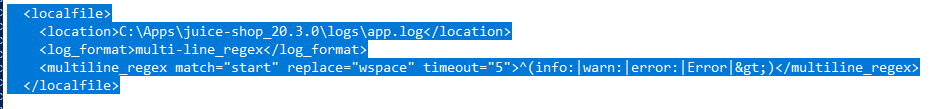

This change groups lines logs together. e.g:
```
Error     
	at Database.<anonymous> (C:\Apps\juice-shop_20.3.0\node_modules\sequelize\lib\dialects\sqlite\query.js:185:27)     
	at C:\Apps\juice-shop_20.3.0\node_modules\sequelize\lib\dialects\sqlite\query.js:183:50     
	at new Promise (<anonymous>)     at Query.run (C:\Apps\juice-shop_20.3.0\node_modules\sequelize\lib\dialects\sqlite\query.js:183:12)     
	at C:\Apps\juice-shop_20.3.0\node_modules\sequelize\lib\sequelize.js:315:28     
	at process.processTicksAndRejections (node:internal/process/task_queues:104:5)
```

This is a sample error log that comes from app.log. My decoder basically groups all this lines after Error together.

And I wrote decoder:
```
<decoder name="juiceshop-sequelize">
        <prematch>^Error\s+at Database.</prematch>
</decoder>

<decoder name="juiceshop-sequelize-fields">
  <parent>juiceshop-sequelize</parent>
  <regex offset="after_parent">\((\S+js):(\d+):(\d+)\)(\.+)</regex>
  <order>error_file,error_line,error_column,stack_trace</order>
</decoder>
```

This is rather simple decoder but what it does is it takes everything after **"Error at Database."** line and takes file name, line,column and stacktrace out of it. I will need it when writing a alert rules for errors.

Now I checked everything with `/var/ossec/bin/wazuh-analysisd`, there is multiple duplicate ID warnings. This is problematic, so I will change ID of multiple rules I have downloaded from socfortress and my own custom ones.


Now I need to install suricata and forward its logs into wazuh.

## Suricata installation

### Skippable Part(Problem)
I just installed suricata on my main host. Since it would be the only logical way. In NAT network type guest OSes can't watch the traffic that is happening with suricata. They need to be able to access to promiscous mode, which lets them to look at vmware's own network flow. This is a security issue so isn't accessible. But main host can enable promiscous mode for virtual network and can watch the traffic in it. 
 
The problem was how could I forward logs of suricata to wazuh-manager. At first I thought making suricata watch netflow and write it to pcap file would be easier. But the thing is pcap would take enormous place and would make post-exploitation analysis harder. So I found the way. 

I could install wazuh agent to my main host also. I know this would seem easier at first sight, but my main host isn't officially supported by wazuh so there wasn't an official build guide. But I finally installed both suricata and wazuh to my main host. 

### Steps in the way of Suricata

There wasn't an official package for my main host(Arch Linux). I installed suricata release v8.0.7 tarball archive from [github](https://github.com/OISF/suricata/releases/tag/suricata-8.0.7) and ran the following commands after extracting archive content with admin privileges:

```
cd suricata-8.0.7
./configure --prefix=/usr --sysconfdir=/etc --localstatedir=/var
make -j$(nproc)
make install-full
```
This command built and installed all of suricata including ready to go ruleset and configurations.

### Suricata configuration
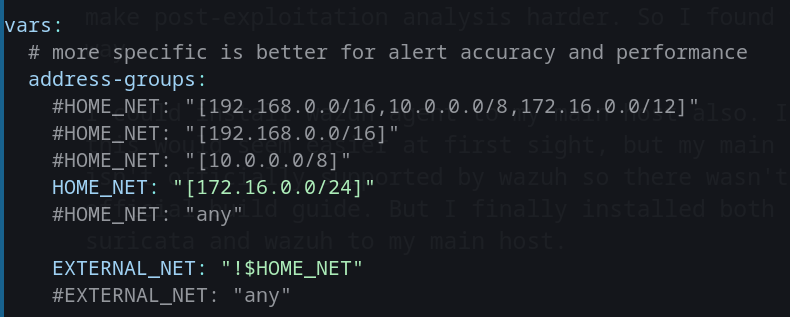

I edited suricata to accept 172.16.0.0/24 as home net and others as external network. this was the only change I have made. 

### Wazuh agent config changes

I changed the address of wazuh-manager to 172.16.77.130 in the config file of wazuh-agent.

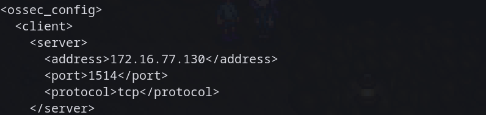

And I removed all non-lab-related log inputs which included journald logs and etc. The only log I redirected was **/var/log/suricata/eve.json**.

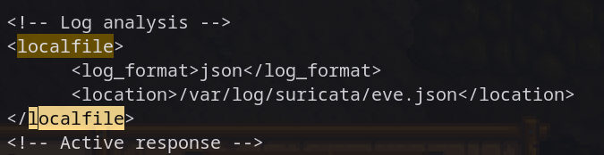

## Wazuh Manager ruleset setup

Wazuh officially packages important rulesets with all-in-one installation. This includes apache,virustotal,basic suricata, basic sysmon rules and many more. But these were not sufficient for me. So I installed some additional community maintained rules.
I found these in [this github link](https://github.com/socfortress/Wazuh-Rules). I have huge respect for this repo's contributors, since I have firsthand experienced how hard it is to write a Wazuh rule. 

I installed [Suricata](https://github.com/socfortress/Wazuh-Rules/tree/main/Suricata), [Sysmon](https://github.com/socfortress/Wazuh-Rules/tree/main/Windows_Sysmon), [PowerShell](https://github.com/socfortress/Wazuh-Rules/blob/main/Windows%20Powershell/) specific rules. And put them into /var/ossec/etc/rules/ directory. And restarted wazuh-manager with `systemctl restart wazuh-manager` line.

This rules had custom lists that needed to be placed to `/var/ossec/etc/lists/` folder and be compiled to .cdb files. After placing them I put their locations in `/var/ossec/etc/ossec.conf` like this:
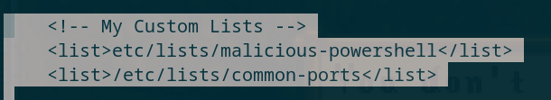

And reloaded wazuh-manager service.

It is correctly done and I tested it via `/var/ossec/bin/wazuh-analysisd -t` command.

## Stone in the pathway
Sysmon ID 3 events wasn't coming to Wazuh Dashboard. I checked the rule contents again and saw SOCFortress have used Olaf Hartong's sysmon config in their rules even though they have clearly stated they are using SwiftOnSecurity's config. What is the difference? Olaf Hartong uses rule.name key and sets it value according to MITRE ATT&CK. Since SwiftOnSecurity doesn't the wazuh decoders couldn't trigger alerts according to current rules. Either I will need to change sysmon config or change the rules. Since It would be easier to change the Sysmon config I tried it.

I uninstalled sysmon using 
` sysmon64.exe -u force`
command. Then I changed the config file in SYSVOL(

`\\\\corp.khachat.com\\SYSVOL\\corp.khachat.com\\scripts\\sysmon\\sysmonconfig.xml`

) with the one I have downloaded from [Olaf Hartong's github repo](https://github.com/olafhartong/sysmon-modular/releases/download/configs-a45dedb13a43/sysmonconfig.xml). Then I rebooted all AD VMs. Since I had a GPO named GPO-Sysmon that was automatically running sysmondeploy.cmd script, it deployed VMs' sysmon with the new config.


I also added additional custom rules which I'm gonna put in [custom rules/]() directory

And here is some of their explanations, though I mainly used wazuh documentation which is updated.


